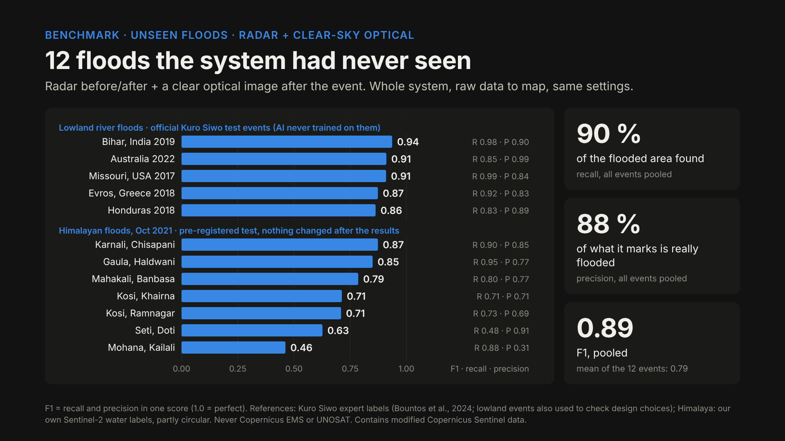

# Flood Damage Mapper — Mapping Flood Damage from Space

Multimodal AI Hackathon 2026, **Track B**. Pick an area on a map, enter a flood date, and the system downloads free
satellite data and answers three questions for rescue teams:

1. **Where did the flood hit?** Flood water from a trained **flood segmentation model** (Sentinel-1 radar, plus Sentinel-2
   optical when the sky is clear). Debris, mud and other surface changes come from a separate change test.
2. **What was damaged?** Buildings, roads, bridges and important facilities (hospitals, schools …) from the
   **pre-event** OpenStreetMap snapshot, checked against the flood map.
3. **Who is cut off?** Settlements that lost their road connection to the nearest town or hospital, ranked by urgency,
   with the road repairs that would reconnect the most people first.

Everything is shown in a **map dashboard** and a **one-page situation report**. Bonus: click any point to trace the flood
path down the valley. Case study: the 26 August 2026 Trishuli flood (Nepal), compared with Copernicus EMS EMSR927
(used **only** to check the results, never as input).

> **Educational prototype, not an operational tool.** Results are a first screening from satellite data and have not
> been verified on the ground.

- Report: [`deliverables/report/report.pdf`](deliverables/report/report.pdf) (Markdown source: [`report.md`](deliverables/report/report.md))
- Demo video (3 min): https://www.youtube.com/watch?v=f9a6ZAEo3pI
- Devpost text: [`deliverables/devpost.md`](deliverables/devpost.md)

**For judges, the fastest way in:**
- **No account, ~5 min:** install (`./install.sh`, press Enter at the key questions), start the app, open *History* → a finished
  example analysis with every layer and the situation report ([details](#4-run-the-web-app)).
- **Your own area and date:** create the free Copernicus key (step 3, ~10 min), then draw an area and press *Run*.
- **Just the numbers:** [Results at a glance](#results-at-a-glance) below, details in the [report](deliverables/report/report.md).
- **Where is what in the repo:** [Repository map](#repository-map).

---

## Quick start (about 15 minutes, most of it creating a free Copernicus account)

### 1. Requirements
Python 3.11 or newer, Git, about 5 GB free disk space and 8 GB RAM. **No GPU needed.** Windows, macOS and Linux work.
(Debian/Ubuntu: also `sudo apt install python3-venv`.)

### 2. Install
```bash
git clone https://github.com/projectilx42-tech/hackathon2-povodne.git
cd hackathon2-povodne
./install.sh            # Windows: double-click install.bat
```
The installer creates a private environment `.venv/` in the project folder (nothing is installed system-wide), installs
the CPU version of PyTorch and the app, checks the model files, and at the end asks for the keys from step 3
(Enter skips). It can be re-run any time.

<details><summary>Manual installation</summary>

```bash
python -m venv .venv && . .venv/bin/activate      # Windows: python -m venv .venv; .venv\Scripts\Activate.ps1
pip install torch torchvision --index-url https://download.pytorch.org/whl/cpu   # Linux / Windows only
pip install -r requirements.txt -r dashboard/requirements.txt -e .
```
</details>

### 3. Free accounts and keys
The judges do not need our accounts — every service is free. Your keys are read only from environment variables or a local
`.env` file and are never stored in the repository. The only key in the code is the shared, quota-limited ohsome key from
the table below.

| What | Why | Needed? | Environment variables |
|---|---|---|---|
| **Copernicus Data Space** | Sentinel-1 and Sentinel-2 images | **yes** | `CDSE_CLIENT_ID`, `CDSE_CLIENT_SECRET` |
| **ohsome API** (HeiGIT) | OpenStreetMap as it was **before** the flood | no — a shared key is built in; get your own at https://account.heigit.org/signup if its daily quota runs out | `OHSOME_API_KEY` |
| CARTO | dark base map | no | `CARTO_API_KEY` |

The model weights are in the repository and the Copernicus DEM is public, so neither needs an account.

**How to get the Copernicus key:**
1. Register at https://dataspace.copernicus.eu (top right → *Register*) and confirm the e-mail.
2. Open https://shapps.dataspace.copernicus.eu/dashboard/#/account/settings → *OAuth clients* → *Create*.
   Copy the client ID and the secret (the secret is shown only once).
3. Paste both when the installer asks (run `./install.sh` / `install.bat` again). They are saved to `.env`, which git ignores.

Or set them in the terminal you start the app from:
```bash
export CDSE_CLIENT_ID=...  CDSE_CLIENT_SECRET=...           # Windows PowerShell: $env:CDSE_CLIENT_ID="..."; $env:CDSE_CLIENT_SECRET="..."
```

### 4. Run the web app
```bash
./start.sh              # Windows: double-click start.bat
```
It opens http://127.0.0.1:8000 (stop with Ctrl+C). Port 8000 busy? Use `./start.sh --port 8001` (Windows: `start.bat --port 8001`).

1. Draw the area (rectangle or free shape). **About 30 × 30 km (900 km²) is recommended**; the app warns above that. Larger
   areas still run, only slower (the ~2,000 km² Trishuli case took 24 min); the app refuses more than 5,000 km².
2. Enter the **flood date**. Optional under *Advanced*: your own *before* / *after* windows and **Sensitivity**
   (default *Sensitive*, the setting all numbers below were measured with; *Standard* is more conservative: fewer false
   alarms, but it misses more flood edges).
3. Press **Run**. A step list shows progress; a 10 × 10 km area takes 2–7 minutes.
4. Results: flood water and debris, damaged buildings, blocked roads and bridges, settlements coloured by access,
   a before/after slider, and the **situation report** to download. Click a settlement for details; click a point to
   trace the flood path.

**Try it without an account:** *History* contains a finished **example run** of the May 2023 Emilia-Romagna flood (Italy),
produced by this pipeline.

### 5. Or from the command line
```bash
.venv/bin/python -m povodne run --aoi 85.15,27.95,85.23,28.03 --event-date 2026-08-26 --out runs/trishuli_small
# Windows: .venv\Scripts\python -m povodne run ...   (or activate .venv first and write just: python -m povodne run ...)
```
`--aoi` is `minlon,minlat,maxlon,maxlat` or a GeoJSON polygon file. Optional: `--pre-window FROM,TO`,
`--post-window FROM,TO`, `--sensitivity standard|sensitive`. The result folder `runs/<id>/` holds `stats.json` (all
numbers), the situation report and the map layers; it also appears in the app's *History*.

### Time and free-tier cost per run
| | ~10 × 10 km | ~2,000 km² (Trishuli case study) |
|---|---|---|
| Run time (CPU only, no GPU) | 2–7 min | 24 min |
| Copernicus processing units (free: 10,000 / month) | ~100 | ~2,200 |

Re-running the same area and date reuses the downloaded images.

### When something goes wrong
| Message | What to do |
|---|---|
| *Sentinel Hub credentials are missing* / *CDSE rejected the credentials* | Put the two Copernicus keys into the file `.env` in the project folder (`CDSE_CLIENT_ID=...`, `CDSE_CLIENT_SECRET=...`; fix or delete wrong lines), or run the installer again if `.env` does not exist. Then restart the app. |
| *the daily request quota of the ohsome API key … is used up* (flood map shown, no damage results) | Create your own free ohsome key, set `OHSOME_API_KEY`, run again. |
| *Not enough satellite data for this area and date* / *insufficient data: no Sentinel-1 pre/post pair* | No radar image of the same orbit exists before and after that date. Try a later date or a wider *after* window. |
| *No significant flooding detected* | Nothing found **in what the satellites could see** — check the data-quality panel (radar shadow, clouds). |
| *Python 3.11 or newer not found* | Install Python from https://www.python.org (Windows: tick *Add python.exe to PATH*) and run the installer again. |

Full log of each run: `runs/<id>/logs/pipeline.log`.

---

## Results at a glance


- **Flood model alone** on Kuro Siwo test floods it never saw in training: flood-class F1 0.79 (best model in the Kuro Siwo
  paper: 0.80). It is a *change detector* (it needs a "before" image); the report shows the cases where it fails.
- **Whole system**, end to end from raw data, on the 12 floods in the chart (same settings everywhere): mean F1 **0.79**.
  5 lowland river floods (Kuro Siwo test events) 0.86–0.94; 7 Himalayan floods fixed **in advance** and run once, nothing
  changed afterwards: 0.46–0.87, mean 0.72.
  Weakest on narrow mountain rivers and debris flows.
- **Development check** (the method was tuned on it, so optimistic): 12 floods on five continents, mean F1 0.81. The
  pre-registered Himalayan test above exists for exactly that reason.
- **Trishuli vs Copernicus EMS EMSR927** (check only, never an input): affected-area precision 0.92, recall 0.78, inside the
  40 km² that EMS analysed (10 m pixels; EMS mapped only parts of the valley).

Details: [report](deliverables/report/report.md), [`validation/results/multievent/README.md`](validation/results/multievent/README.md),
model training: [`training/README.md`](training/README.md).

## How it works
```
area + flood date
  → download: Sentinel-1 before/after from the same orbit track, Sentinel-2 when clear, Copernicus DEM,
    OpenStreetMap snapshot from the day before the flood
  → preprocessing: one 10 m grid, radar shadow mask, slope, height above the nearest stream
  → flood water: U-Net model (radar before/after + slope), optical model when clear
  → debris / mud: change test against older radar passes
  → damaged buildings, roads, bridges → road network before vs after → who is cut off
  → stats.json (single source of every number) → situation report + dashboard
```

**Data rules we follow:** inputs are only Sentinel-1, Sentinel-2, Copernicus DEM, OpenStreetMap **before** the event and
the training datasets Kuro Siwo and Sen1Floods11. Copernicus EMS, UNOSAT or any other damage map is **never an input** —
not for training, thresholds or the pipeline; EMSR927 is used only in `validation/`. Nothing is hard-wired for Nepal.

## Repository map
| Folder | What is in it |
|---|---|
| `src/povodne/` | The pipeline: `acquire/` (download) → `preprocess/` → `flood/` (+ `debris/`) → `damage/` → `network/` (cut-off analysis) → `floodpath/` → `report/`; `cli.py` is the entry point |
| `dashboard/` | Web app: `server.py` (FastAPI) + `static/` (MapLibre front end, vendored, works offline apart from base maps); `sample_run/` is the bundled example shown under *History* |
| `models/` | The two trained flood models used by default (radar `floodseg_v0.5`, optical `floodseg_s2_v0.1`) with their model cards |
| `training/` | How the flood model was trained and evaluated (Kuro Siwo, Sen1Floods11), see [`training/README.md`](training/README.md) |
| `validation/` | Whole-system checks on independent floods and the Trishuli comparison with EMSR927 (check only), see [`validation/README.md`](validation/README.md) |
| `deliverables/` | Report (PDF + Markdown source), Devpost text, benchmark slide |
| `tools/` | Small one-off checks behind design decisions (Sentinel-1 calibration, terrain, event-day pass) |
| `tests/` | Unit and integration tests, no keys needed |
| `docs/` | Internal design notes (Czech): task, module contracts, UI notices |

## Limitations
- Satellites pass only every few days: the system cannot warn ahead of a sudden event.
- Steep valleys hide parts of the ground from radar (shadow); narrow, fast mountain rivers look like land to radar.
- Muddy debris and wet soil are hard to tell apart without a clear optical image; debris thresholds come from the literature.
- OpenStreetMap is incomplete in remote areas; footpaths are not in the road network; no population estimates.
- Helicopter landing-zone candidates come from the elevation model only and are **not verified**.

Full list: report, section *Limitations*.

## For developers
Tests (no keys needed): `pip install pytest pytest-xdist`, then `python -m pytest -q -n auto tests training/tests`.

## AI assistance
This project was built with **Claude Code** (Anthropic) as a coding assistant. The team set the goals, the data rules and
the test protocol and reviewed every result; Claude Code helped write and test the code and draft the documents:
- **Data download and preprocessing** (`src/povodne/acquire/`, `src/povodne/preprocess/`)
- **Flood segmentation model** (`training/`): data preparation, model design, training and evaluation
- **Flood map** (`src/povodne/flood/`): debris change test, combining water and debris, confidence map
- **Damage, road network, cut-off analysis and flood path** (`src/povodne/damage/`, `network/`, `floodpath/`)
- **Situation report, dashboard and installer** (`src/povodne/report/`, `dashboard/`, `install.py`)
- **Validation** against Copernicus EMS (`validation/`, check only)
- **Submission materials** (this README, `deliverables/`)

The team is responsible for all submitted code and can explain how it works.

## Data attributions and citations
- Contains modified Copernicus Sentinel data 2026.
- Produced using Copernicus WorldDEM-30 © DLR e.V. 2010–2014 and © Airbus Defence and Space GmbH 2014–2018 provided under
  COPERNICUS by the European Union and ESA; all rights reserved.
- © OpenStreetMap contributors. Data available under the Open Database License (ODbL); pre-event snapshot via the ohsome API (HeiGIT).
- Training data: **Kuro Siwo** — Bountos, N. I. et al. (2024). *Kuro Siwo: 33 billion m² under the water. A global multi-temporal
  satellite dataset for rapid flood mapping.* NeurIPS 2024 Datasets and Benchmarks. **Sen1Floods11** — Bonafilia, D., Tellman, B.,
  Anderson, T., Issenberg, E. (2020). *Sen1Floods11: a georeferenced dataset to train and test deep learning flood algorithms for
  Sentinel-1.* CVPR Workshops 2020.
- Dashboard base maps (display only, never an input): © OpenStreetMap contributors; OpenTopoMap (CC-BY-SA);
  EOxCloudless by EOX IT Services GmbH (contains modified Copernicus Sentinel data); © CARTO (if a key is set).
- Validation only (never used as input): European Union, Copernicus Emergency Management Service data (EMSR927).

## License
The code in this repository is released under the [MIT License](LICENSE). The data it uses keeps its own licenses (see
attributions above).

## Responsibility
This disaster is recent and many families are still affected. This project uses no images of victims. It is an
educational prototype built for a hackathon, not an operational tool.
