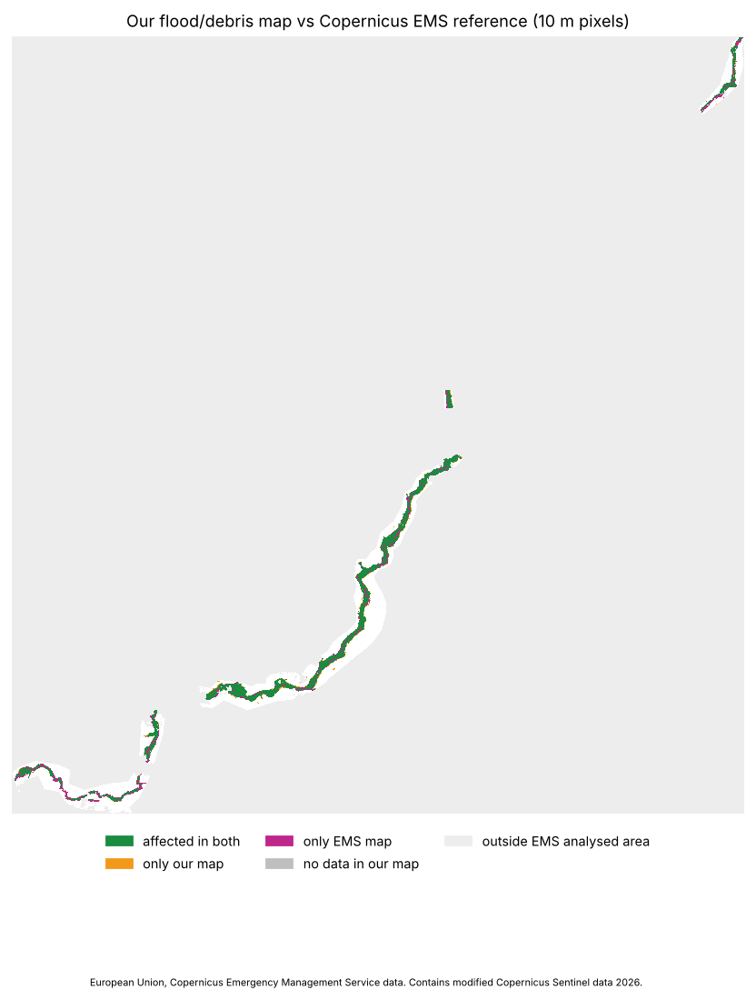

# 1. Problem
When roads, bridges and phone lines are gone, rescuers need to know where the damage is and who is cut off. Our system takes
**an area and a flood date** and, from free satellite data only, answers: **(1) where did the flood hit, (2) what is damaged,
(3) who is cut off.** It runs end-to-end from raw satellite data for any area and date (nothing is hard-wired for Nepal).
Case study: the 26 August 2026 Bhote Koshi–Trishuli flood. This is an educational prototype, not an operational tool.

# 2. Data (allowed sources only)
Sentinel-1 radar and Sentinel-2 optical images (Copernicus Data Space / Sentinel Hub, AWS Open Data), Copernicus DEM GLO-30,
OpenStreetMap **as it was before the event** (ohsome API snapshot at 00:00 UTC the day before; never Overpass or live OSM),
and the training datasets Kuro Siwo and Sen1Floods11. **Copernicus EMS, UNOSAT or any published damage map is never an input**
— not for training, thresholds or pipeline; EMSR927 appears only in `validation/` and in Section 8 to check finished results.
Thresholds are set from training data or literature, never tuned on EMSR927.

# 3. System overview
```
area + date → download (area only): S1 before/after, same orbit track, both pass directions; S2 if clear; DEM; OSM snapshot
 → preprocessing (10 m UTM grid, layover/shadow mask, slope, HAND)
 → flood water (AI model)   → debris / mud / flooded vegetation (change test)
 → final flood map → damage (buildings, roads, bridges, facilities)
 → road network before vs after → cut-off settlements, repair order
 → stats.json → one-page situation report + map overlays → dashboard
```
Steps communicate through files in one run folder; `stats.json` is the single source of every number in the dashboard and report.
Key rules: radar change detection uses **pre and post from the same relative orbit**; the "before" image is checked so that it
is not already flooded (water-fraction time series, earlier image used if needed); the main track is the earliest post-event
image unless the opposite direction sees the valley floor clearly better. If no usable pair exists, the system says
*insufficient data*; if nothing is found it says *no significant flooding* **together with coverage** (what could be seen).

# 4. AI component: flood segmentation model
**Model.** U-Net with ResNet34 encoder (ImageNet initialisation, allowed by the organisers), 7 input channels: before/after
VV and VH backscatter (dB), their differences, and terrain slope; 3 classes (no water / permanent water / flood). Trained on
Kuro Siwo (Bountos et al., 2024) plus Sen1Floods11 (Bonafilia et al., 2020) with Lovász loss; probabilities calibrated
(temperature 0.92). Sentinel-1 is processed to match Kuro Siwo (sigma0, Lee 7×7 + 3×3 mean): measured bias 0.00 dB, speckle 0.96×
of Kuro Siwo on 28 tiles. Runs on a CPU (~30 s per 30×30 km per track). An optional optical U-Net (ResNet18, Sentinel-2) adds water
where the sky is clear. Post-processing: no water on slopes > 15° or HAND > 30 m, radar shadow checked from both directions,
patches < 0.1 ha removed; *Standard* and *Sensitive* modes (probability threshold 0.25).

**Results** (radar model v0.5; events never seen in training; pixels pooled):

| Test | Water class | Precision | Recall | F1 | IoU |
|---|---|---|---|---|---|
| Kuro Siwo test (10 events, 15 896 tiles) | flood | 0.865 | 0.731 | **0.792** | 0.656 |
| Kuro Siwo test | permanent water | 0.816 | 0.754 | 0.784 | 0.644 |
| Kuro Siwo test | water total | 0.893 | 0.779 | 0.832 | 0.713 |
| Kuro Siwo test, mountain tiles (relief > 200 m), earlier model v0.4 | flood | – | – | 0.48 | – |
| Sen1Floods11 Bolivia (held out), no "before" image | water total | 0.958 | 0.109 | **0.195** | 0.108 |
| Sen1Floods11 Bolivia, "before" = "after" (no change) | water total | 0.889 | 0.495 | 0.636 | – |
| Optical model, Sen1Floods11 Bolivia (held out) | water | 0.899 | 0.872 | **0.885** | 0.794 |

For reference, the best model in the Kuro Siwo paper reaches F1 0.801 on these events. We report the Bolivia numbers **honestly**:
the radar model learned to rely on change between before and after, so with no "before" image it rarely reports water (F1 0.20);
Bolivian water is also bright in radar (median −16 dB). That setting is not how the pipeline runs (it always has a "before" image),
but it shows the model is a **change detector, not a general water detector**. Differences between model variants after
round 3 are within seed noise (val score ±0.007); the only clearly repeatable gain came from the terrain-slope input.

**Whole pipeline on 14 independent events** (`validation/results/multievent/`). The table above scores the model on tiles; the
judges' question is whether the *whole system* works anywhere from raw data. We ran it end to end (download → final map, Sensitive
mode) on 13 floods on five continents and one dry-season no-flood control, all with references that are **not** EMS/UNOSAT:
Kuro Siwo test hand labels (Australia, Bihar, Chad, Evros, Honduras, Malawi, Missouri), Sen1Floods11 (Bolivia) and, for mountain
events where no dataset exists, our own Sentinel-2 water labels (Teesta, Chamoli, Swat, Kathmandu, Baghlan). Water-label events are scored on water only (debris is not in such a label). Every method change was
accepted only if the mean improved, no event lost more than 0.01 F1 and the control gained no false area.

| events | recall | precision | F1 |
|---|---|---|---|
| 9 original floods (mean) | 0.86 | 0.88 | **0.87** |
| 12 floods incl. 3 added mountain floods (mean) | 0.85 | 0.80 | **0.81** |
| lowland/large rivers: Australia, Bihar, Bolivia, Evros, Malawi, Missouri, Swat | 0.85–0.99 | 0.81–0.99 | 0.87–0.94 |
| Honduras / Teesta / Chad | 0.83 / 0.64 / 0.67 | 0.89 / 0.90 / 0.79 | 0.86 / 0.75 / 0.72 |
| Baghlan / Kathmandu (flash floods, water already drained) | 0.68 / 0.86 | 0.68 / 0.21 | 0.68 / 0.34 |
| Chamoli 2021 (debris flow; 0.04 km² of water in label, not in the means) | 0.06 | 0.48 | 0.11 |

Large river floods are found reliably; narrow mountain channels and flash floods are the weak point. Kathmandu and Baghlan had only
0.10 / 0.35 km² of water left on the label date, so a fraction of a km² of extra water halves precision; their debris (1.5 km²) cannot
be checked against a water label. A full run takes 2–7 min for a ~9 km window on a laptop CPU. Caveats: Sentinel-2 labels can share
the image the pipeline uses (Baghlan), and the method changes were chosen on this same set.

# 5. Debris, mud and other surface change
Mud, rock and flooded vegetation/buildings do not look like open water in radar: debris and wet mud often darken only slightly,
flooded vegetation and towns **brighten** (double bounce). A separate statistical step compares each pixel with its own history
(up to 4 earlier passes of the same track), combines both pass directions, grows regions from strong seeds, and labels
subtypes (debris, mud, erosion, flooded vegetation, flooded / damaged buildings, unknown) with a confidence level using Sentinel-2
and OSM building/land-use when available. A **self-test on a flood-free image pair** estimates how much of the result may be false;
a weather check (change over the surrounding slopes) rejects rain and wet snow. Measured on the Trishuli valley floor:
6.3 % darkening vs 0.4 % brightening; on Opava 2024: 0.5 % / 13.6 %. Tested on a synthetic valley (all subtypes ≥ 90 %, no false
pixels elsewhere); real-data thresholds come from literature on floods and landslides, **not measured on Himalayan debris flows**.
Results are therefore shown as indicative, with confidence.

# 6. Damage
Per object, not per village: a building is *affected* if its outline plus a 10 m margin overlaps the flood map, *likely destroyed*
if debris/erosion lies under it, *possibly affected* if only the margin or low confidence. Roads are *blocked* at ≥ 17 % of length
or ≥ 30 m continuous in the flood zone (stricter rules cut false closures from 16 % to 5 %, Kasmalkar 2020). Bridges: water under a
bridge is not evidence of damage; approaches and debris are tested → *blocked / suspect / passable*. Counts are given as a range
(certain only … including "possible"), like UNOSAT's "potentially affected". No population estimates (only OSM `population` if present).

# 7. Who is cut off
We build our own road graph from the pre-event OSM snapshot (networkx; OSMnx would use live OSM). Post-event graph = pre-event
graph without blocked road pieces and blocked bridges; a settlement is *connected*, *degraded* (detour > 2×), *possibly cut off*
(cut only if suspect bridges/possible blockages are counted), *cut off*, or *no road before the event*. Destinations: hospitals,
towns and the edge of the downloaded network. Output includes detour %, walking time, blocking road pieces, a five-level impact
grade per settlement with reasons, an urgency ranking, and a **stepwise repair plan** (which road section reconnects the most
buildings per repaired section). Helicopter landing-zone candidates from slope in the DEM are always marked *unverified*.
Bonus: a click on the map traces the flood path downstream (D8 flow direction on the DEM) and lists settlements, bridges and
facilities along it, ordered downstream — no hydraulics, no arrival times.

# 8. Case study: Trishuli flood vs EMSR927
Run `trishuli_now`: area 85.0–85.4 °E, 27.8–28.2 °N (~2 000 km²), event date 26 Aug 2026, post-event Sentinel-1 image
28 Aug; EMS images 27 Aug (Phosretar 31 Aug). EMS products of 4 areas (Syapru Besi, Timure, Bidur, Phosretar); the other two were
cancelled because of clouds. **EMS was used only for this comparison**, after the run, never as input or for tuning
(European Union, Copernicus Emergency Management Service data). Scored inside the EMS analysed areas where our map has data (40.4 km²).

| check | result |
|---|---|
| Affected area (our new water + debris vs EMS observed event, 10 m pixels) | precision **0.92**, recall **0.79**, F1 **0.85**, IoU 0.73 (ours 9.97 km², EMS 11.66 km²) |
| EMS damaged buildings (3 376) inside our affected area (±10 m) | **79 %**; destroyed/damaged only: **90 %** |
| EMS damaged roads (64 km) near roads we mark blocked | **85 %** (91 % incl. "possibly blocked"); false alarms: 23 % of EMS "no visible damage" roads |
| EMS destroyed/damaged bridges matched to OSM (14 of 25) | **93 %** marked blocked or suspect |

Whole area: new water 9.8 km², debris/mud 79.6 km², 7 400–9 300 buildings affected (959 likely destroyed), 480–1 170 km of road
blocked or possibly blocked, 22 bridges blocked + 14 suspect; **45 settlements cut off, 73 possibly cut off**. Run time 24 min
(download 6 min, debris step 10 min) and ~2 200 of 10 000 free monthly processing units. Inside the EMS footprint our map has
5.1 km² water and 4.1 km² debris — EMS maps one class (mass movement), so only the union is scored. The overall confidence is
*low* (72 % of affected pixels low confidence): steep valley, radar shadow, and debris thresholds from literature.
Caveats: 10 m pixels vs sub-metre hand mapping; image dates differ; EMS lists only damaged buildings, so building precision cannot
be computed (396 of our 1 979 hit buildings in the area are not in EMS: false alarms or EMS omissions); only small parts of the
valley were mapped by EMS.

{width=45%}

# 9. Limitations (what the system cannot do)
- **Revisit time.** Sentinel-1/2 pass an area only every few days (about 6–12 days per track). The system maps what was there on
  the image dates; it **cannot warn of a sudden event such as a glacier collapse minutes ahead** and may miss short-lived water.
  A very recent flood may have no "after" image yet; the app then says so and when a better view is expected.
- **Radar shadow and layover** in steep valleys hide part of the ground. Two pass directions help but do not cover everything;
  the data-quality panel states what share was visible.
- **Narrow, fast mountain rivers** look like land to radar (rough water, channel 2–6 pixels wide): mountain recall 0.06–0.95, weakest
  for debris flows (Chamoli); flash-flood water is often gone before the next pass.
- **Clouds** (monsoon) limit optical use; then only radar is used.
- **Debris vs wet soil.** Debris/mud detection is heuristic, with literature thresholds not measured on Himalayan debris flows;
  C-band does not penetrate dense forest; streets aligned with the radar look direction hide urban flooding.
- **The model is a change detector** (see Bolivia result) and is weaker on mountain terrain than on plains (F1 0.48 vs 0.78).
  Differences between variants are within noise.
- **OpenStreetMap is incomplete** in remote areas (roads, bridges, buildings missing) and its pre-event state is all we know.
  Footpaths and footbridges are not part of the road network, so a village reachable only by a path is "no road before the event".
- **10 m pixels:** a "hit" building means flood on or beside it, not a damage grade; no depth or flow velocity.
- **No population estimates**; landing-zone candidates are from the DEM only (trees, wires and obstacles are unknown).
- **No ground truth** was used to tune thresholds; reference comparison only at the end (Section 8).
- **"No significant flooding"** means nothing was found in the available data, not that nothing happened.
- Needs free accounts (Copernicus, ohsome) and internet; the 30×30 km area limit is a time and quota choice.

# 10. Responsibility
The disaster is recent and many families are still affected. We use no images of victims. Results are a first screening from
satellite data, unverified on the ground, and must not be the sole basis of rescue decisions.

# 11. AI assistance
Code, documentation and this report were developed with **Claude Code** (Anthropic); the team reviewed and can explain every part.
Details per module are in the README (section *AI assistance*).

# 12. Attributions and citations
Contains modified Copernicus Sentinel data 2026.
Produced using Copernicus WorldDEM-30 © DLR e.V. 2010–2014 and © Airbus Defence and Space GmbH 2014–2018 provided under COPERNICUS
by the European Union and ESA; all rights reserved.
© OpenStreetMap contributors (ODbL).
Training data: Bountos, N. I. et al. (2024), Kuro Siwo, NeurIPS Datasets and Benchmarks; Bonafilia, D. et al. (2020), Sen1Floods11, CVPR Workshops.
Validation only: European Union, Copernicus Emergency Management Service data (EMSR927).
