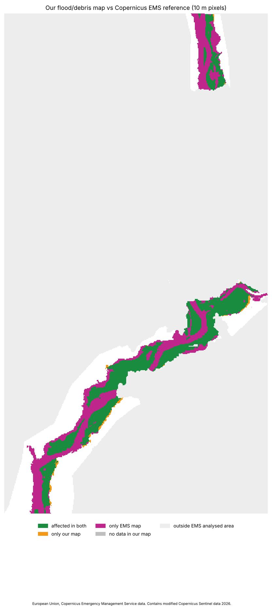

# Comparison with Copernicus EMS EMSR927 — run `trishuli1`

Reference: European Union, Copernicus Emergency Management Service data. Used **only to check results**, never as input or for tuning.

- Our post-event Sentinel-1 image: 2026-08-28; EMS VHR images: 2026-08-27, 2026-08-31
- EMS products used: AOI01_GRA_PRODUCT_v1, AOI02_GRA_PRODUCT_v2, AOI03_GRA_PRODUCT_v1, AOI05_GRA_PRODUCT_v3
- Compared area (EMS analysed area ∩ our valid pixels): 3.0036 km²

## Affected area (pixel level, 10 m)

| | km² |
|---|---|
| ems affected | 1.5984 |
| ours affected | 0.8816 |
| both | 0.8534 |
| only ours | 0.0282 |
| only ems | 0.745 |

IoU 0.525, precision 0.968, recall 0.534, F1 0.688.
EMS maps the whole event as one class (mass movement), so water and debris are not scored separately; inside the EMS footprint our affected pixels are water 0.56 km², debris 0.2934 km².

## Buildings

EMS damaged buildings in compared area: 750 {'Destroyed': 673, 'Damaged': 45, 'Possibly damaged': 32}.
Share inside our affected area (±10 m): 87.6 % (destroyed/damaged only: 90.7 %).
Matched to an OSM building: 584; of those flagged by us: 89.2 %. Our hit buildings in the area: 497, of which not listed by EMS: 78 (EMS lists only damaged buildings, so these are either our false alarms or EMS omissions).

## Roads

EMS damaged roads 10.462 km, of which near our blocked roads 87.7 %; EMS 'no visible damage' roads 4.714 km, of which we flag 29.4 % (false alarms). Including our 'possibly blocked': 89.7 % / 35.0 %.

## Bridges

EMS bridges in compared area: 6 {'Destroyed': 6}; matched to OSM bridges: 3; recall (ours blocked or suspect): 100.0 %.

## Limitations

- EMS maps were drawn by hand (photo-interpretation) from very-high-resolution optical images (~0.3–1 m); we use 10 m Sentinel data. Narrow features (single houses, roads, small channels) are below our resolution.
- Image dates differ: EMS images and our post-event Sentinel-1 pass are not from the same day; changes in between (receding water, new slides, clean-up) count as disagreement.
- EMS labels the whole event as 'mass movement / landslide'; our map separates new water and debris, so only the union is scored.
- EMS lists only damaged buildings (points), so building precision cannot be computed; our extra hits may be EMS omissions.
- Our buildings, roads and bridges come from the pre-event OpenStreetMap snapshot; EMS uses its own reference layers. Objects that exist in only one source are matched by distance (buffers listed under params).
- Only the EMS mapped areas are compared (small parts of the valley); results elsewhere are not checked.

